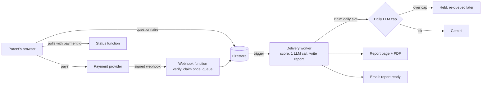

# DharmaCode: engineering notes and code samples

[DharmaCode](https://dharmacode.net) is a live AI career-guidance product for Indian parents of Class 9 to 12 students. A parent answers a 20 to 30 minute questionnaire, pays, and gets a personalised report: ranked career paths, colleges, subject strategy and a plan.

The product repo is private, because the prompts, question bank and scoring weights are the product. This repo shows **how it is built**: the architecture, the decisions behind it, and the parts that keep it safe, cheap and correct, extracted into small modules with tests.

## Architecture



| Layer | Tools |
| --- | --- |
| Frontend | React 18, TypeScript, Vite, Tailwind CSS, static prerendering for SEO |
| Backend | Firebase Cloud Functions (2nd gen), Firestore, Cloud Scheduler |
| AI | Google Gemini, one call per report |
| Payments and email | Dodo Payments (Standard Webhooks), Resend |

## Key decisions

1. **Scoring in code, writing by the LLM.** Archetypes, Big Five and interest profiles are scored deterministically. The model writes the narrative but never produces a score, so every number in a report is explainable.
2. **One LLM call per report.** Cost is about US$0.04 a report, with token usage logged on every report.
3. **Webhooks return fast; a worker does the work.** The webhook verifies, claims the payment once and queues it. A database trigger runs generation, which can take minutes.
4. **Every paid action is idempotent.** Providers retry webhooks. Claiming the payment id in a transaction means a retry or a replay never generates or emails twice.
5. **Hard cost ceilings (built and tested, rollout pending).** A daily cap on LLM calls, per-IP rate limits and a render budget for PDFs, so a spike or abuse can't produce a surprise bill.
6. **Ownership, not email, unlocks a report.** The status endpoint needs the payment id from the buyer's own redirect; an email on its own is refused.
7. **User text is data, never instructions.** Typed answers go into the prompt in one labelled, delimited block.

## Code samples

| Module | What it shows |
| --- | --- |
| [`src/webhooks/verifySignature.ts`](src/webhooks/verifySignature.ts) | Standard Webhooks HMAC check on the raw body, constant-time compare, secret rotation |
| [`src/pipeline/claimOnce.ts`](src/pipeline/claimOnce.ts) | Exactly-once processing: claim, then queued to processing, with retry after error |
| [`src/limits/dailyCap.ts`](src/limits/dailyCap.ts) | Transactional daily LLM cap with a single alert per day |
| [`src/limits/rateLimiter.ts`](src/limits/rateLimiter.ts) | In-memory per-IP limiter with bounded memory; IPs are never stored |
| [`src/limits/renderBudget.ts`](src/limits/renderBudget.ts) | Per-report and site-wide budget checked before an expensive render |
| [`src/llm/untrustedText.ts`](src/llm/untrustedText.ts) | Cleaning and delimiting user text before it reaches the model |
| [`src/access/reportStatus.ts`](src/access/reportStatus.ts) | Ownership check and a minimal public response |
| [`src/store/memoryStore.ts`](src/store/memoryStore.ts) | In-memory transactional store standing in for Firestore in tests |

Each decision is a pure function where possible, with the transaction as a thin wrapper, so the rules can be tested without a cloud project. The tests include concurrency cases: ten simultaneous webhook deliveries produce one claim, and twenty simultaneous LLM claims never exceed the cap.

## Run the tests

Requires Node 22.

```bash
npm install
npm test            # 29 tests
npm run typecheck   # strict TypeScript
```

## How it was built

Built by one person directing AI coding agents (Lovable for the first version, then Claude Code): a `CLAUDE.md` in the product repo holds the rules, architecture and gotchas the agents read before every change, and nothing ships without tests and an owner's sign-off.

## License

All rights reserved. Shared for review.
